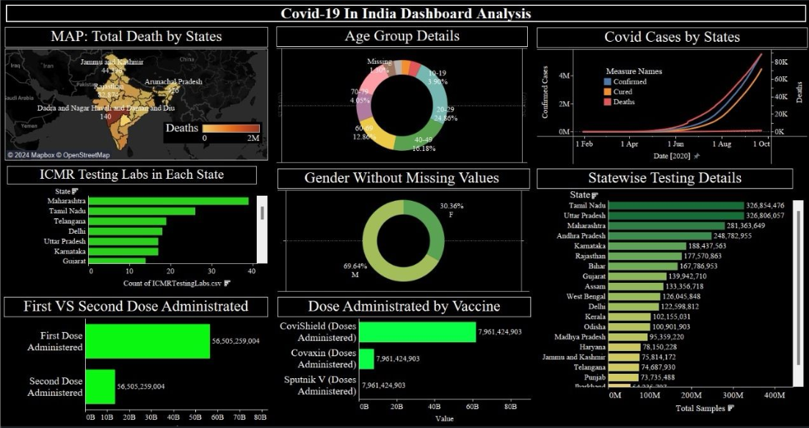

# 🦠 COVID-19 India Dashboard Analysis | Tableau

An interactive Tableau dashboard analyzing COVID-19 trends in India, including confirmed cases, deaths, age-group distribution, gender demographics, state-wise testing, and vaccination statistics.

## 📊 Dashboard Preview



*Dashboard preview featuring state-wise deaths, COVID-19 case trends, age-group distribution, gender demographics, testing facilities, and vaccination analysis.*

## 📌 Project Overview

This project focuses on exploring COVID-19 data in India using Tableau to transform multiple datasets into meaningful visual insights.

The dashboard combines geographical maps, trend charts, demographic visualizations, and state-wise comparisons to present different aspects of the pandemic. It enables users to explore reported COVID-19 cases, deaths, testing statistics, and vaccination-related information through an organized visual interface.

## 🎯 Project Objectives

- Analyze COVID-19 case trends across the reporting period.
- Visualize state-wise distribution of reported deaths.
- Explore age-group and gender distributions.
- Compare state-wise testing statistics.
- Examine vaccination doses and vaccine-category distributions.
- Present public-health data through interactive visualizations.

## 🔍 Dashboard Features

### 🗺️ 1. State-Wise Death Analysis

- Uses a geographical map to visualize reported COVID-19 deaths across Indian states.
- Helps explore differences in recorded deaths between regions.
- Presents geographical patterns through color-coded indicators.

### 📈 2. COVID-19 Case Trends

- Visualizes confirmed cases, recoveries, and deaths over time.
- Highlights changes in reported cases during the displayed period in 2020.
- Enables comparison of the three measures through trend lines.

### 👥 3. Age-Group Distribution

- Examines the distribution of records across age categories.
- Includes age groups such as 10–19, 20–29, 40–49, 60–69, and 70+.
- Includes a category for missing age information.

### ⚧️ 4. Gender Distribution

- Visualizes gender distribution among records with available gender information.
- Displays the proportions of male and female records.
- Helps explore the demographic composition of the available data.

### 🧪 5. ICMR Testing Laboratories

- Compares the number of ICMR testing laboratories across states.
- Highlights states with higher recorded laboratory counts.
- Supports geographical comparison of testing infrastructure.

### 💉 6. Vaccination Analysis

- Compares first-dose and second-dose administration figures.
- Visualizes the distribution of administered doses by vaccine category, including Covishield, Covaxin, and Sputnik V.
- Supports exploration of vaccination statistics across the dataset.

### 📊 7. State-Wise Testing Details

- Compares reported testing sample counts across states.
- Highlights differences in recorded testing volumes.
- Helps users explore state-level testing data.

## 🛠️ Tools & Technologies

- **Tableau** — Interactive dashboard development and data visualization
- **Data Integration** — Combining multiple COVID-19 datasets
- **Geographical Visualization** — Mapping state-wise data
- **Trend Analysis** — Exploring reported cases over time
- **Demographic Analysis** — Age-group and gender distribution
- **Data Storytelling** — Presenting public-health information visually

## 💡 Key Analytical Takeaways

- The dashboard provides a consolidated view of reported COVID-19 statistics across multiple dimensions.
- Time-series charts help visualize changes in reported cases, recoveries, and deaths.
- Geographical maps and state-wise charts support comparisons of deaths and testing statistics.
- Demographic visuals reveal the distribution of available records across age groups and gender categories.
- Vaccination charts provide a visual comparison of dose-related statistics and vaccine categories.

*The dashboard reflects the data and reporting period represented in the underlying datasets. Visualized patterns should not be interpreted as proof of causation or as current public-health statistics.*

## 📂 Repository Structure

```text
Tableau-Covid19/
│
├── README.md
├── COVID-19.png
├── covid_19_india.csv
├── covid_vaccine_statewise.csv
├── StatewiseTestingDetails.csv
└── archiveCovid-19.zip
```

*This structure follows the files visible in your repository screenshot. Keep only the files you intend to publish, and ensure the dashboard image and workbook filenames match the paths used in this README.*

## 🚀 How to Explore the Project

1. Clone or download this repository.
2. Install Tableau Desktop or use a compatible Tableau viewing option.
3. Open `COVID19_Dashboard.twbx`.
4. Explore the visualizations and available interactive controls.
5. Compare reported case trends, demographics, state-wise testing, and vaccination statistics.

## 📚 Skills Demonstrated

- Tableau dashboard development
- Data visualization and storytelling
- Geographical and time-series analysis
- Demographic data analysis
- Multi-source data integration
- Public-health data exploration
- Analytical thinking and insight communication

## 🎯 Project Takeaway

This project strengthened my ability to combine multiple datasets and transform public-health statistics into an interactive visual dashboard. It demonstrates how Tableau can support exploratory data analysis and communicate complex trends through geographical, demographic, and time-series visualizations.

## 👨‍💻 Author

**Shrey Gandhi**

Computer Science Engineer | AI/ML & Data Analytics Enthusiast | Power BI | Tableau | 

---

⭐ If you find this project useful, feel free to explore the repository and share your feedback.
